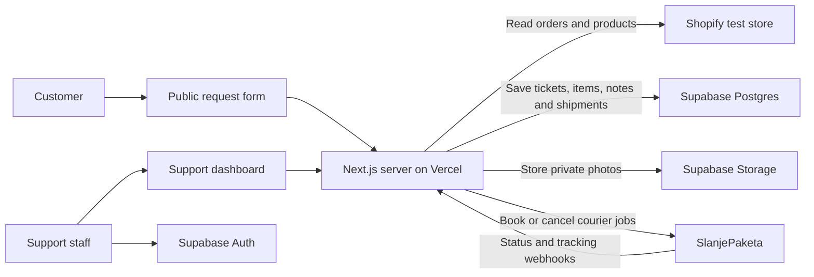

# App analysis and testing guide

Reviewed on 20 October 2026. This guide describes the supplied source code, rather than assuming every README claim is implemented. No external accounts, stores, database projects, or deployments were configured during the review.

## 1. What the app does

This is a Serbian-language support portal for cash-on-delivery orders, built with Next.js 14, React, and Tailwind. Customers open `/zahtev`; staff open `/admin/tiketi` and sign in through Supabase Auth.



Shopify stores the original orders and catalog. Supabase stores support requests. Vercel runs the web interface and server endpoints. SlanjePaketa handles the physical shipment workflow.

**Shopify access is read-only in this code.** Creating or approving a ticket does not refund a Shopify payment, create a Shopify return or replacement order, update fulfillment, or reserve/restock inventory. Support must perform those tasks separately. Bank transfers are also manual.

This is a separately hosted website. There is no theme app extension, app proxy, Shopify login callback, or embedded App Bridge interface in this repository. Add a normal storefront menu/footer link to the hosted `/zahtev` URL. A theme duplication alone does not provide a separate order database; use a separate development store.

### Customer flow

1. Choose exchange (`ZAMENA`) or refund (`REFUNDACIJA`).
2. Enter **both** the order number and phone number. The server finds the order by number and compares the phone with the order/shipping phone after Serbian phone normalization. The README's suggestion that either value alone works is incorrect.
3. Select returned line items. The UI uses the full ordered quantity for each selected line; there is no partial-quantity selector.
4. For an exchange, select another variant of the same product or a different active product with stock. A variant is selectable only when Shopify reports it available for sale and its inventory quantity is greater than zero.
5. For a refund, select a reason per item, provide an 18-digit bank account, account owner, received date, and acceptance of the refund terms. The bank check validates digit count, not account ownership or checksum. The 14-day condition is displayed and acknowledged; elapsed days are not enforced.
6. Confirm contact information. Exchanges also collect the replacement address. Both flows require one receipt photo and one to three product photos. Images are compressed in the browser and uploaded before final submission.
7. Submit. The server creates a ticket such as `ZR-00001`, its item rows, and photo references. The browser displays a confirmation page.

The confirmation page says to expect an email, but there is no email delivery integration. A successful confirmation also does not mean a courier has been booked.

### Staff flow

Staff can filter/search tickets, view details and privately stored photos, add notes, change status, enter tracking manually, copy a tab-separated row into Google Sheets, archive, and permanently delete tickets. The Sheets feature copies to the clipboard; it does not connect to a Google account.

The status dropdown offers new, in progress, approved, and rejected. The closing actions for completed/rejected requests both archive the ticket and record the outcome in a note. Archiving can optionally delete photos. Ticket and courier statuses are separate: courier delivery does not automatically close the support ticket.

Staff can book a pickup from the customer, then send a replacement after the pickup reaches the warehouse. An explicit force option can bypass the warehouse-arrival check. Replacement cash-on-delivery surcharge is entered by staff; the app does not calculate a price difference from Shopify. Cancellation is allowed while the courier order is `PROCESSING`.

Refund requests omit the shipping address from their saved payload. Support must enter a pickup address in the courier dialog for these requests.

## 2. Recommended testing arrangement

Use three stages, with synthetic customer details and photos:

| Stage | Services connected | What it establishes |
| --- | --- | --- |
| Local demo | None | UI/API responses with fixtures; no persistence or real authentication |
| Connected staging | Shopify development store + separate Supabase project + Vercel staging project | Real order lookup, ticket persistence, login, private photo access |
| Courier testing | The staging stack plus a provider-approved SlanjePaketa test arrangement | Booking, cancellation, status callbacks, tracking and surcharge |

A dedicated Vercel project called, for example, `zamene-staging` is straightforward. Its stable `*.vercel.app` URL can use Vercel's Production deployment environment while still being **your staging app**, provided every credential points to test resources. Do not confuse Vercel's environment label with the business purpose of that project.

Keep live and staging Supabase projects and Shopify credentials separate. There is no per-shop tenant isolation in the ticket tables. Although a helper accepts a second Shopify configuration, the public lookup/product flows use only the primary store; this is not a complete multi-store portal.

## 3. Supabase setup

1. Create a dedicated hosted Supabase project, such as `zamene-staging`. Choose a European region and retain its database password in your password manager.
2. Open SQL Editor and execute the migration files in this exact order:
   - `supabase/migrations/0001_init.sql`
   - `supabase/migrations/0002_paketi.sql`
   - `supabase/migrations/0003_admin_panel.sql`
   - `supabase/migrations/0004_ticket_shipments.sql`
3. Check that all four runs succeed. Migration 0001 supplies shared functions used by later migrations and creates the private `ticket-images` bucket. In Storage, verify that bucket exists and **Public is off**. Create it manually only if it is missing; the README unnecessarily instructs you to create it again.
4. Keep row-level security enabled. Do not add anonymous read/write policies to make a failing API call work: public ticket creation and uploads already use a privileged server client.
5. Under Authentication, keep email/password sign-in enabled. **Disable new-user signup and anonymous sign-in.** Create support users manually under Users, with confirmed email and known test passwords.
6. Under Authentication URL Configuration, set Site URL to your stable staging origin. Allow localhost and the exact staging URLs you use when testing redirect-based auth features. The current login uses email/password directly, so an OAuth callback is not needed. Invite/recovery callback pages are not implemented.
7. Obtain the project URL and API keys from Connect / Settings > API Keys. Enter them using the exact environment names in the next section.

Every authenticated Supabase user is currently treated as support staff. Disabling public signup is essential: hiding the signup UI alone would not prevent account creation through the Auth API. [Supabase auth configuration](https://supabase.com/docs/guides/auth/general-configuration)

For new keys, put the publishable key into this app's existing `NEXT_PUBLIC_SUPABASE_ANON_KEY` variable and the backend secret key into `SUPABASE_SERVICE_ROLE_KEY`. The variable names do not determine the key format; the code passes the values to the SDK. Legacy `anon`/`service_role` keys remain available for compatibility, but Supabase recommends the new key types. Only the URL and public/publishable key belong in browser-visible variables. [Supabase API keys](https://supabase.com/docs/guides/getting-started/api-keys)

You do not need a database connection string, Prisma, Supabase Edge Functions, a separate backend server, or a Realtime subscription for the current features. Keep Supabase's Data API available: the app uses the Supabase client API.

Expected main tables: `tickets`, `ticket_items`, `ticket_images`, `ticket_notes`, and `ticket_shipments`. The other migrations also create `order_followups`, `app_settings`, `incoming_shipments`, `transport_options`, and `panel_cache`. Their package/report/owner-panel features have no corresponding pages or endpoints in this checkout. Updating `admin_panel_emails` is not required for the ticket dashboard and does not restrict who can access tickets.

Use [Supabase's redirect URL guidance](https://supabase.com/docs/guides/auth/redirect-urls) if you later implement invitations, password recovery, or OAuth. Adding redirect URLs alone does not implement those flows.

## 4. Shopify development-store setup

Create a development store from the [Dev Dashboard](https://dev.shopify.com/dashboard), inside the same organization as the app. Use recent test orders and synthetic Serbian contact details. Shopify supports a test payment gateway for development stores. [Development stores](https://shopify.dev/docs/apps/build/stores/development-stores)

Create an app using **Start from Dev Dashboard**, give it a staging name, and release a version with `read_orders` and `read_products`. Configure it as a standalone integration rather than embedding this website in Shopify admin. Set App URL to the staging dashboard URL, or use Shopify's default app-home URL while hosting is pending. Install it on the development store, then retrieve Client ID and Client secret from app settings. Scope changes need a new version and store approval. [Dashboard app setup](https://shopify.dev/docs/apps/build/dev-dashboard/create-apps-using-dev-dashboard)

The code already exchanges these credentials for a token and caches it until shortly before expiry. This is the **client credentials grant**, rather than Shopify's separate session-token exchange flow. The app and store must belong to the same Shopify organization. Collaborator access to a client's store does not satisfy this condition; that deployment would need another supported OAuth flow implemented in the app. [Client credentials requirements](https://shopify.dev/docs/apps/build/authentication-authorization/client-credentials-grant)

The query reads names, addresses, phone, and email from order fields. Avoiding the `customer` object does not remove protected-customer-data requirements. Configure access to the necessary fields where required by your app configuration; development-only testing does not need the production review. [Protected customer data](https://shopify.dev/docs/apps/launch/protected-customer-data)

Use `SHOPIFY_API_VERSION=2026-10` for the staging evaluation, then run the connected tests below. The existing queries passed schema validation for that version, with deprecation notices for image fields. The bundled `2024-10` default is retired; Shopify silently serves the oldest accessible stable version when a requested version is inaccessible. Do not rely on this fallback. [API versioning](https://shopify.dev/docs/api/usage/versioning)

Prepare these fixtures:

| Fixture | Setup |
| --- | --- |
| Shoe A | Active product, Size `40`, `41`, `42`; positive inventory on 40/41, zero on 42; unique SKU per variant |
| Shoe B | Another active product with numeric sizes, SKU and stock |
| Simple product | One available variant and SKU |
| Sold-out product | No available inventory |
| Order A | Completed order, Shoe A + simple product, order/shipping phone `+381641234567`, Serbian address and email |
| Order B | Another recent order with a different phone |

Keep sufficient replacement inventory after placing test orders. Use the order number shown in Shopify, such as `1001` or `#1001`; do not enter the numeric database ID from the admin URL. Draft orders must first become actual orders.

The code recognizes option names containing `Size`, `Veličina`, `Velicina`, or `Broj`, and `Color` or `Boja`. Size parsing expects numbers. A size option with only `S/M/L` values cannot be selected through the numeric size picker without a code change. Set store currency to RSD for these tests because the UI and courier amounts assume dinars.

`read_orders` normally covers the latest 60 days; older-order access needs `read_all_orders` in addition. Start with new orders rather than broadening access unnecessarily. [Access scopes](https://shopify.dev/docs/apps/build/authentication-authorization/manage-access-scopes)

## 5. Environment variables

Use `.env.local` for local development and Vercel project environment variables for hosting. Do not commit real credentials. Retain these exact names even when using newer Supabase key types.

| Variable | Value for connected staging | Visibility |
| --- | --- | --- |
| `NEXT_PUBLIC_SUPABASE_URL` | Supabase staging project URL, including `https://` | Public |
| `NEXT_PUBLIC_SUPABASE_ANON_KEY` | Project publishable key, or compatible legacy anon key | Public |
| `SUPABASE_SERVICE_ROLE_KEY` | Project backend secret key, or legacy service-role key | Server only |
| `SUPABASE_STORAGE_BUCKET` | `ticket-images` | Server |
| `SHOPIFY_STORE_DOMAIN` | `your-test-store.myshopify.com`, with no protocol or trailing slash | Server |
| `SHOPIFY_CLIENT_ID` | Installed test app Client ID | Server |
| `SHOPIFY_CLIENT_SECRET` | Same app Client secret | Server only |
| `SHOPIFY_API_VERSION` | `2026-10`, followed by connected regression tests | Server |
| `DEMO_MODE` | `false` or unset for connected tests; exactly `true` for demo | Server |
| `SLANJEPAKETA_BASE_URL` | Provider-confirmed API root; example file uses `https://slanjepaketa.rs/api/v1` | Server |
| `SLANJEPAKETA_TOKEN` | Provider-approved test token; leave unset until courier testing | Server only |
| `SLANJEPAKETA_COURIER` | Optional; defaults to `DEXPRESS` | Server |
| `SP_WEBHOOK_KEY` | Long random shared secret for courier callbacks | Server only |

Keep `SHOPIFY_ADMIN_TOKEN` unset for the new client-credentials setup. That legacy fallback, if populated, takes precedence over Client ID/secret and can accidentally connect with the wrong old credentials.

There is no required `DATABASE_URL`, app-origin variable, or email-provider key in the current implementation. A Vercel/Supabase integration is optional; if it creates differently named variables, map their values to the names above.

## 6. Local demo and connected local testing

In PowerShell from the project folder, create `.env.local` from `.env.example` only if it does not already exist:

```powershell
if (-not (Test-Path -LiteralPath '.env.local')) {
  Copy-Item -LiteralPath '.env.example' -Destination '.env.local'
}
npm.cmd ci
npm.cmd run dev
```

For the demo, set `DEMO_MODE=true`. The README and example incorrectly say `1`, which does not enable it. Keep a placeholder `SHOPIFY_STORE_DOMAIN=demo-test.myshopify.com`; the demo ticket-detail page still uses that value to construct its Shopify link. No real Shopify credentials are needed. Demo login/logout is not a real authentication test.

Open `http://localhost:3000/zahtev` and `http://localhost:3000/admin/tiketi`. Nonempty order-number and phone inputs return fixture data. For a complete submission, still supply a Serbian-format phone, required photos, and the fields required by the chosen flow.

Demo submissions and staff actions do not persist. A submitted demo ticket will not appear in the fixture ticket list; refresh can restore fixture values. Courier actions do not book anything.

For connected local tests, populate the real **staging** service values, change `DEMO_MODE=false`, and restart Next.js. When using a production build, rebuild after changing environment values, especially demo mode and `NEXT_PUBLIC_*` values.

The supplied lockfile currently resolves Supabase JS 2.110.0, which requires Node >=22. The review used Node 24.20.0. Use Node 24 locally and on Vercel to reproduce that baseline; Node 22 is also within the dependency requirement, but was not tested here.

## 7. Vercel setup

1. Put this project in your own private Git repository. No Git repository was present in the supplied folder at review time. Exclude `.env.local`, `node_modules`, and `.next` using the supplied `.gitignore`.
2. Import the repository as a new Vercel project. Select Next.js, with the directory containing `package.json` as Root Directory.
3. Use Node 24.x, install command `npm ci`, build command `npm run build`, and the default Next.js output configuration. There is no separate frontend/backend deployment.
4. Add all connected-staging environment variables before deploying, with `DEMO_MODE=false`. If this is the dedicated staging project's main deployment, select Vercel's Production environment. Set Preview values separately if using branch previews, and Development values if pulling them locally.
5. Deploy and retain the stable project URL. Later environment changes require another deployment. In particular, Next.js public variables are included in the built browser bundle.
6. Verify `/zahtev` loads and logged-out `/admin/tiketi` redirects to login. Sign in with the manually created support user, submit a real staging ticket, refresh, and verify it remains.
7. Add an external link to `https://YOUR-STAGING-HOST/zahtev` in the development store's navigation/footer. Staff use `https://YOUR-STAGING-HOST/admin/tiketi`.

Vercel scopes variables separately for Production, Preview, and Development. A successful deployment with the wrong scope can still have missing credentials. [Environment variables](https://vercel.com/docs/environment-variables)

Node versions are selected in the project's Build and Deployment settings. [Supported Node versions](https://vercel.com/docs/functions/runtimes/node-js/node-js-versions)

Keep staging protected while investigating the issues below. External courier callbacks must also pass Vercel Deployment Protection. If enabled, use Vercel's automation bypass facility for those provider URLs, in addition to the app's `key` parameter; do not publish the bypass secret. A browser that loads successfully for a logged-in Vercel user does not prove the provider can reach it. [Protection bypass](https://vercel.com/docs/deployment-protection/methods-to-bypass-deployment-protection/protection-bypass-automation)

You can test order lookup, ticket persistence, images, and staff actions without configuring SlanjePaketa. Those features do not require a courier token.

## 8. SlanjePaketa setup and boundary

The app sends real HTTP requests to the configured API whenever staff confirm a courier booking in connected mode. `DEMO_MODE=false` is not a courier sandbox, and a Shopify test order does not make an external courier job a test job.

Ask SlanjePaketa for a test account/token or an explicitly agreed test process, the correct API root, usable courier identifier, warehouse/return address configuration, and active test catalog SKUs. Confirm the meaning of shipping payer fields on that account. The implementation uses `Authorization: Private <token>`, `/product-orders`, `PICK_UP_PACKAGE` / `SEND_PACKAGE`, and defaults to D Express. These are findings from the source; provider behavior and sandbox availability were not verified. Start from the [provider's API documentation](https://slanjepaketa.rs/api).

Both the returned and replacement Shopify SKUs must correspond to the appropriate active SP catalog entries. A Shopify SKU alone does not create an SP product. The app sends pickup product amounts as zero, uses `SENDER` for pickup postage, and `RECIPIENT` for replacement postage. Confirm who the provider bills for each before a physical test.

Configure these callback URLs in the provider's settings:

```text
https://YOUR-STAGING-HOST/api/sp/order-status?key=YOUR_SHARED_SECRET
https://YOUR-STAGING-HOST/api/sp/order-code?key=YOUR_SHARED_SECRET
```

Both routes accept POST and PUT. They look up `ticket_shipments.custom_number` using payload `id`, for example `ZR-00001-P` or `ZR-00001-Z`. **Do not use the provider's internal order ID in that field.**

Status callback example for a matching test shipment:

```json
{"id":"ZR-00001-P","status":"DELIVERED","notes":"Approved test event"}
```

Tracking callback example:

```json
{"id":"ZR-00001-Z","code":"TEST-TRACKING-001"}
```

Statuses accepted by the implementation: `PROCESSING`, `SENT`, `DELIVERED`, `RETURN`, `CANCELED`, and `REJECTED`; several `wc-dover-*` equivalents are also mapped. Unknown statuses and unmatched IDs receive a successful ignored response. Therefore HTTP 200 alone does not prove a database row changed.

The dashboard also refreshes active shipment statuses from SP when loading/refreshing the courier card. There is no scheduled background poll. Webhooks update shipment status/notes and replacement tracking but do not process a refund or archive a ticket.

Until a provider-approved testing arrangement exists, leave its token unset and test the portal without confirming courier bookings. To simulate callbacks without an actual booking, create a synthetic shipment row only in the isolated test database and send callbacks to that reference; the dashboard's active-status refresh may still attempt an SP lookup for its fake provider ID.

## 9. Test checklist and expected results

Run demo checks first, then repeat the connected cases with demo disabled. Check actual database/storage/provider state as well as the page response.

| Test | Expected result / observation |
| --- | --- |
| Correct order + matching phone | Order and its live Shopify items load |
| `#1001` vs `1001`; local vs `+381` phone | Equivalent values find the same order |
| Wrong phone or nonexistent number | Same generic not-found response; no order details |
| Missing lookup fields | HTTP 400 |
| Sixth lookup within 10 minutes on one instance/IP | HTTP 429; distributed enforcement is not guaranteed |
| Same-model exchange | Available size/color can be chosen and saved |
| Different-product exchange | Active in-stock catalog product can be selected |
| Sold-out variant | Cannot be selected in the normal UI |
| Non-size product | Available variant is selected or offered correctly |
| Numeric and letter sizes | Numeric works; S/M/L exposes the current picker limitation |
| Refund validation | Missing reason, short bank number, missing date or unchecked terms blocks continuation/submission |
| Old received date | Current code accepts it with confirmation; record this as a business-rule gap |
| Photo requirements | One receipt + at least one product photo; up to four total |
| Contact -> review -> back to contact | Check whether photos disappear and need uploading again; section state is currently local to the mounted step |
| Phone camera / mobile gallery | Readable receipt, correct orientation, normal JPEG/PNG/WebP upload; test real iPhone formats separately |
| Large file on Vercel | A payload exceeding 4.5 MB can fail before the app's 10 MB check |
| Real submission | HTTP 201; one `tickets` row, selected `ticket_items`, and matching `ticket_images` rows |
| Persistence | Ticket and notes remain after browser refresh and a new login |
| Private images | Staff can load signed URLs; raw unauthenticated bucket URLs fail |
| Login / logout / private API | Unauthenticated dashboard redirects; a valid admin API call without a session receives 401 |
| Filter/search/status | Results and counters agree with stored tickets |
| Copy for Sheets | Clipboard pastes into the intended columns; no automatic Sheets update |
| Archive with and without photo removal | Archived ticket retained; photos removed only when requested |
| Permanent delete | Typed confirmation required; ticket children and related image objects removed |
| Courier pickup | Only under provider-approved testing; booking exists both in SP and `ticket_shipments` |
| Send before pickup delivered | HTTP 409 unless staff explicitly force it |
| Replacement with surcharge | Test SKU, recipient, amount, payer and shipment reference match the agreed provider test |
| Bad webhook key | HTTP 403 |
| Valid status/tracking callback | Matching row changes; exchange tracking mirrored to the ticket |
| Duplicate callback | Same shipment status does not create another identical status-change note |
| Cancel and retry | Cancellation only while processing; use a fresh ticket until the retry bug below is fixed |

## 10. Findings to address before real customer use

These are source findings, not a claim that the live integrations have been penetration-tested.

| Priority | Finding | Consequence / next action |
| --- | --- | --- |
| Before public exposure | Public image DELETE accepts any provided storage path and deletes through the service-role client, without ownership verification | Bind uploads/deletes to a verified request or draft. A private bucket does not protect an unauthenticated privileged endpoint |
| Before public exposure | Final ticket submission trusts browser-provided order/items/SKUs/prices and image paths; it is not bound to the verified order lookup | Revalidate order ownership and line items server-side; verify quantities, replacement eligibility, image ownership and current stock |
| Before public exposure | All Supabase authenticated users are support admins | Disable signup now; add explicit staff authorization before broadening identity features |
| Before public exposure | Upload and submission endpoints have no rate limiter; lookup limiter is in-memory only | Add abuse controls appropriate to public use; instance restarts and scale-out reset/split the lookup allowance |
| Before production | Next.js is pinned to 14.2.35, on an unsupported major | Upgrade to a supported release and rerun connected and deployment tests |
| Before production | Build warning: current Supabase SDK uses a Node API in Edge middleware | Verify real-session login/refresh on Vercel; resolve middleware/dependency compatibility during the upgrade |
| Before promising 10 MB uploads | App accepts 10 MB, but its upload passes through a Vercel function with a 4.5 MB payload limit | Enforce a smaller compressed upload size or implement signed direct-to-storage uploads; multipart overhead also counts |
| Before courier retries | Courier reference is fixed per ticket, while the database has a unique index on that reference | After cancellation, a retry may book externally then fail to save locally. Add retry-safe references/idempotency and reconciliation |
| Before unattended courier use | SP booking happens before local shipment insertion; missing-SKU lines are filtered out | Verify every item has a mapped SKU and reconcile external success/local failure; prevent partial bookings |
| Business behavior | Refund age is not enforced; bank accounts only checked for 18 digits | Decide and implement the intended validation |
| Business behavior | Confirmation promises email without an email sender; terms/privacy links are `#` placeholders | Implement the promised features or correct the copy and replace the links |
| Data reliability | Photo-row insert failure is logged but does not fail ticket creation; abandoned uploads have no scheduled cleanup | Verify photos after submission and add monitoring/cleanup appropriate to usage |
| Form navigation | Photo section state resets when returning to the contact step | Preserve uploaded photo state across steps and avoid orphaned uploads |
| Scale/catalog | Only first 50 order lines, first 100 variants and first 100 catalog products are fetched | Add pagination if the intended store exceeds those limits |

Vercel documents the [4.5 MB function payload limit](https://vercel.com/docs/functions/limitations). Next.js lists version 14 among [unsupported versions](https://nextjs.org/support-policy).

Do not reset the test database's ticket sequence and reuse an SP account containing earlier matching references. Independent staging/live databases both start at `ZR-00001`; separate provider accounts or environment-specific references avoid collisions.

## 11. Troubleshooting

| Symptom | First checks |
| --- | --- |
| Demo tries to connect to real services | Use exactly `DEMO_MODE=true`, restart/rebuild |
| Demo ticket detail fails | Supply a placeholder `SHOPIFY_STORE_DOMAIN` |
| `shop_not_permitted` | App/store must appear in the same Shopify organization |
| Shopify 401/403 | Installation, released scopes, domain and matching Client ID/secret; unset an unintended legacy token |
| Order lookup returns not found | Correct display order number; matching order/shipping phone; recent real order; protected field access |
| No exchange stock | Product active; inventory tracked and positive; selectable size format; replacement stock remains after test order |
| Login fails | Supabase URL/public key, correct project user, email confirmation and password; demo disabled |
| Ticket appears successful but missing | Demo still enabled, different Supabase project, filters, or inspect Vercel logs and table rows |
| Photos fail | Private bucket exists, correct backend key/bucket name, supported type, compressed request size |
| Ticket list errors | All four migrations succeeded, especially the shipment table used by the list join |
| Courier error | Provider-approved token/base URL, active mapped SKUs and complete address; inspect SP before retrying |
| Webhook seems successful with no update | `id` is custom reference, payload status is recognized, matching row exists; inspect database errors/logs |
| Webhook receives platform HTML/login | Vercel Deployment Protection blocked it before the route |

Use Vercel build/runtime logs, Supabase Auth logs, database rows and Storage objects, plus SP's order list. Avoid logging secrets or complete customer request bodies.

## 12. What was actually verified

- Installed the locked dependencies without changing application source or dependency versions.
- `npm run lint`: passed with no ESLint warnings/errors.
- `npm run build`: passed on Node 24.20.0 with demo/placeholder configuration. It produced the Supabase/Edge warning described above.
- Validated all four existing Shopify GraphQL operations against the 2026-10 schema. All passed. The cost query is unused by current routes and needs `read_inventory` if later activated; current ticket/catalog flows use `read_orders` and `read_products`.
- Started the production build locally in demo mode. Confirmed home redirect, public form, dashboard and sample ticket pages; mock order lookup; product list and variants; two mock uploads; successful exchange and refund submissions (HTTP 201); rejection of a short bank number and missing photos (HTTP 400); and rejection of an invalid webhook key (HTTP 403).
- Did not verify real Shopify token issuance, actual Supabase login/persistence/storage, Vercel-hosted behavior, email delivery, or real courier operations. Those require the connected test environment described above. The smoke checks were HTTP checks, not a full browser click-through.

Useful source entry points, relative to this project: `components/wizard/WizardForm.tsx`, `app/api/tickets/route.ts`, `lib/shopify/client.ts`, `lib/shopify/orders.ts`, `lib/shopify/products.ts`, `lib/supabase/server.ts`, `lib/supabase/middleware.ts`, `lib/slanjepaketa.ts`, and `app/api/sp/`.
