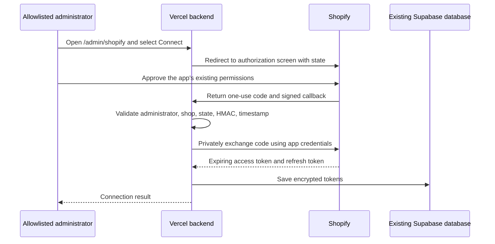

# Shopify OAuth: how this connection works

## What OAuth means here

OAuth is a standard for delegated access. The merchant tells Shopify that this app
may read specific store data. Shopify then issues a credential for the app. The
merchant's Shopify password stays with Shopify.

The previous backend used `client_credentials`: it sent its Client ID and Secret
directly to Shopify to obtain a token. That grant only works for an app and store
owned by the same Shopify organization. TENZIA is a collaboration store under the
developer organization, so this integration instead uses the **authorization code
grant**, with a merchant approval step.

No external identity provider or new hosting service is added. Shopify authorizes
access, the existing Vercel backend processes it, and the existing Supabase project
stores the encrypted connection record.

## The two flows



This is an administrator setup flow. A customer does not perform these steps.

The customer's browser continues to call `/apps/zamene/...` on TENZIA's own domain.
Shopify forwards that request to Vercel. Vercel reads the saved token, refreshes it
when necessary, calls Shopify, and sends the result back through the proxy. The
customer stays on the Shopify page for the exchange/refund form.

## Terms used in the implementation

| Term | Purpose |
| --- | --- |
| Client ID | Identifies the Shopify app; it is not the API access token. |
| Client Secret | Server-only proof of the app's identity. It stays in Vercel environment variables. |
| Scopes | Approved capabilities: `read_orders`, `read_products`, `write_app_proxy`. |
| Authorization code | A temporary, single-use value returned after approval. It is exchanged immediately and is not stored. |
| Callback/redirect URL | The registered Vercel endpoint Shopify may return the administrator to. |
| State | A random value tying the callback to the browser that started the connection, preventing request forgery. |
| HMAC | A signature the official Shopify SDK validates to check the callback came from Shopify. |
| Offline access token | A store-wide app credential that works when the merchant is not browsing the app. It is not a customer login. |
| Refresh token | A server-only credential used to obtain the next expiring access token without another approval screen. |

## Changes by project

- **14 Zamena / Vercel:** connection screen, authorization routes, encrypted token
  storage adapter, token renewal, and an OAuth branch in the shared Shopify client.
- **Existing Supabase:** one new table, `public.shopify_oauth_connections`, keyed by
  store and Client ID. Migration `0005_shopify_oauth.sql` only adds this table and
  restricts its privileges. Existing users, tickets, images, tables and policies
  are retained.
- **Shopify app:** use a standalone app URL and register the callback below.
  Existing scopes and the storefront proxy remain the same.
- **15 Zamena Test Store:** no theme code changes are required for OAuth.

## Security and renewal

The connection page and both authorization routes require a real Supabase user
whose email is in the existing `app_settings.admin_panel_emails` allowlist. Demo
mode does not bypass this check. Starting a connection also requires a POST from
the configured Vercel origin. Only stores explicitly configured in the backend
can be connected.

The official `@shopify/shopify-api` SDK handles the authorization redirect, signed
state cookie, callback HMAC/timestamp validation, code exchange, and refresh grant.
An additional signed cookie binds the flow to the initiating administrator, shop,
app, and state. The SDK state cookie expires after one minute: approve promptly,
or start a fresh connection if it expires. Tokens are never returned to the
browser; the admin dashboard continues using Supabase login.

Tokens are encrypted with AES-256-GCM using a random IV and an independent,
server-only encryption key. The encrypted payload is bound to its store and Client
ID. `anon` and `authenticated` database roles have no access to the table; the
backend service role can read, insert and update it. SDK exceptions and callback
URLs are not logged by the application; failures log only a safe error category.
Vercel's platform request logs may contain callback query parameters, so restrict
access to deployment logs and avoid copying callback URLs into support messages.

The backend refreshes an access token when it is within one minute of expiry and
stores the replacement access and refresh tokens. A database lease prevents
simultaneous refreshes across Vercel instances. A revision check prevents a late
401 from an older request from invalidating a newly authorized connection. A
revoked token or expired refresh token requires the administrator to reconnect.
If a store is idle beyond its refresh token's lifetime, reconnect on next use.

## Activation checklist — not performed by the local implementation

1. Review and run `supabase/migrations/0005_shopify_oauth.sql` in the existing
   project's Supabase SQL Editor as the database owner. This creates no tickets.
2. Use Node.js 22 or 24 for the Vercel project; SDK 15 requires Node 22 or newer.
3. Keep the matching TENZIA app Client ID and Secret already saved in Vercel.
   Set `SHOPIFY_STORE_DOMAIN=e5uh9b-rn.myshopify.com`,
   `SHOPIFY_AUTH_MODE=oauth`, and
   `SHOPIFY_APP_URL=https://vercel-zamena-app.vercel.app`.
4. Generate an independent 32-byte encryption key, for example with
   `node -e "process.stdout.write(require('node:crypto').randomBytes(32).toString('base64'))"`.
   Enter it privately as `SHOPIFY_TOKEN_ENCRYPTION_KEY` in Vercel Production.
   Keep a secure copy: changing it makes existing connection records unreadable
   until they are authorized again. Do not commit or send the key in chat.
5. Deploy the reviewed backend changes. Keep the database migration and environment
   settings ahead of the first connection attempt. Existing modes remain available:
   an unset `SHOPIFY_AUTH_MODE` uses the previous client-credentials/static-token
   path. A second store has its own `SHOPIFY_AUTH_MODE_2`.
6. Release a new version of **zamene-app-tenzia** with these settings:

   | Setting | Value |
   | --- | --- |
   | App URL | `https://vercel-zamena-app.vercel.app/admin/shopify` |
   | Embedded in Shopify admin | `false` |
   | Allowed redirect URL | `https://vercel-zamena-app.vercel.app/api/shopify/auth/callback` |
   | Scopes | `read_orders,read_products,write_app_proxy` |
   | App proxy destination | Keep `https://vercel-zamena-app.vercel.app/api` |
   | Installed storefront proxy | Keep `/apps/zamene` |

   Do not change the separate Purplefox staging app to configure TENZIA.
7. Ensure the support administrator's email is listed in the existing
   `app_settings` row with key `admin_panel_emails`, and the backend service role can
   read that existing table. The OAuth migration does not change its grants or
   allowlist. Sign into the existing Vercel support dashboard with that administrator,
   open `/admin/shopify`, select TENZIA's connection button and approve in Shopify.
   Reinstalling the app is not required by this implementation. The button can
   request reconnection of the existing app installation.
8. Confirm a connection record is present and check order lookup through the TENZIA
   preview. A lookup with nonexistent synthetic input should return the normal
   order-not-found result, not a connection/authentication error. Then verify a known
   order privately. No ticket or courier booking is needed to test authentication.

Optional read-only database permission verification after migration:

```sql
select
  has_table_privilege('service_role', 'public.shopify_oauth_connections', 'SELECT') as server_can_read,
  has_table_privilege('service_role', 'public.shopify_oauth_connections', 'INSERT') as server_can_insert,
  has_table_privilege('service_role', 'public.shopify_oauth_connections', 'UPDATE') as server_can_update,
  has_table_privilege('anon', 'public.shopify_oauth_connections', 'SELECT') as anonymous_can_read,
  has_table_privilege('authenticated', 'public.shopify_oauth_connections', 'SELECT') as browser_user_can_read;
```

Expected values: `true, true, true, false, false`.

## Local verification

Run `npm run test:shopify-oauth`, `npm run lint`, and `npm run build`. The OAuth tests
use the real SDK with simulated HTTP, database and administrator responses; they
never connect to a live store, create a ticket, or change customer data. Live merchant
approval, actual database grants, and the full storefront connection require the
activation steps above and cannot be confirmed by these local tests.

## Rollback

Redeploy the previous backend revision and restore the previous Shopify app launch
configuration if necessary. The new database table is independent of ticket data
and can remain in place. Leaving `SHOPIFY_AUTH_MODE` unset preserves legacy behavior;
it does not make client credentials valid for a collaboration store.

## Official references

- [Standalone/API-only OAuth](https://shopify.dev/docs/apps/build/authentication-authorization/authenticate-standalone-apps)
- [Client credentials organization restriction](https://shopify.dev/docs/apps/build/authentication-authorization/client-credentials-grant)
- [Access tokens and refresh rotation](https://shopify.dev/docs/apps/build/authentication-authorization/access-tokens)
- [Official Shopify Node SDK](https://github.com/Shopify/shopify-app-js/tree/main/packages/apps/shopify-api)
